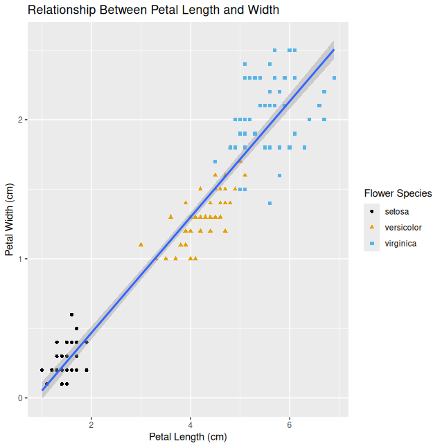

# R-Iris: Biological Data Visualisation with ggplot2

A small R project exploring biological measurements through data visualisation using **ggplot2** and the built-in Iris dataset.

## Overview

This project explores the relationship between petal length and petal width across three Iris flower species:

- *Iris setosa*
- *Iris versicolor*
- *Iris virginica*

The objective is to visualise species-specific measurement patterns and examine the overall linear relationship between two morphological variables.

## Dataset

The project uses R's built-in `iris` dataset.

| Feature | Description |
|---|---|
| Sepal.Length | Sepal length (cm) |
| Sepal.Width | Sepal width (cm) |
| Petal.Length | Petal length (cm) |
| Petal.Width | Petal width (cm) |
| Species | Iris species |

**Dataset characteristics:**
- 150 observations
- 3 flower species
- 4 numerical measurement variables
- 1 categorical variable

## Visualization



The visualisation uses:
- `geom_point()` — Displays individual observations.
- `geom_smooth()` — Adds a linear regression trend.
- `aes()` — Maps species to colour and point shape.
- `labs()` — Defines plot titles and axis labels.
- `scale_color_colorblind()` — Applies a colour-blind-friendly palette.

## Technologies Used

- R
- RStudio
- ggplot2
- ggthemes

## Installation & Execution

Install the required packages:

```r
install.packages("ggplot2")
install.packages("ggthemes")
```

Load the libraries and execute the script:

```r
library(ggplot2)
library(ggthemes)

source("first-ggplot-project.R")
```

## Key Learning Outcomes

Through this project, I explored:

1. Loading and working with biological datasets in R.
2. Creating scatterplots using ggplot2.
3. Mapping categorical variables to visual aesthetics.
4. Applying linear regression visualisations.
5. Customising plot labels and colour scales.

## Learning Reference

This project was developed as part of my independent learning in R and biological data visualisation, drawing inspiration from a ggplot2 example shared in an Instagram educational summary of *R for Data Science*.

The implementation uses the built-in Iris dataset as a practical exercise.

---

**Author:** Shreyas Bhat

**Repository:** [R-Iris](https://github.com/Shreyas-the-1st/R-Iris)
